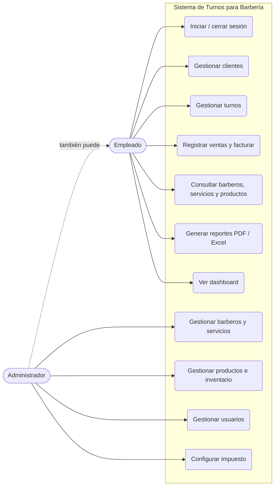
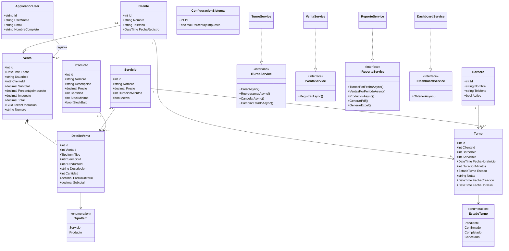
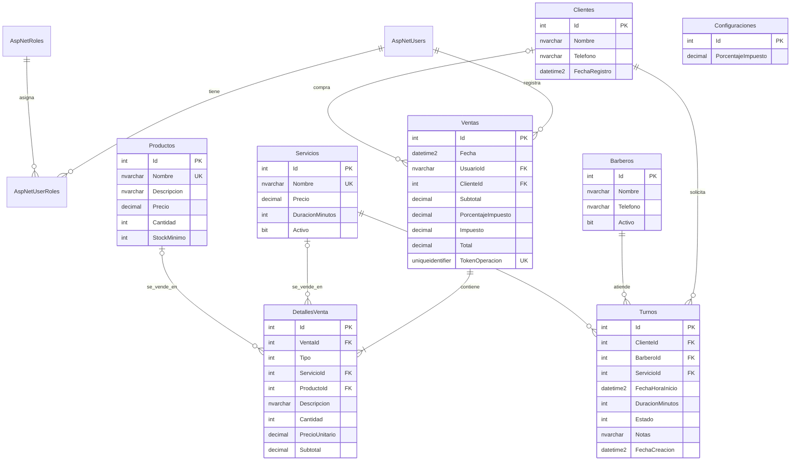

# Sistema de Turnos para Barbería

**Asignatura:** Programación III  
**Universidad:** Universidad Abierta para Adultos (UAPA), República Dominicana  
**Equipo:** 3 integrantes (completar nombres y matrículas): ______________________  
**Profesor:** ______________________  **Fecha:** ______________________

---

## 1. Título
Sistema de Turnos para Barbería: aplicación web para administrar turnos, clientes, barberos, servicios, productos, ventas y reportes.

## 2. Introducción
Las barberías pequeñas suelen llevar sus citas y ventas en libretas o mensajes, lo que provoca turnos duplicados, olvido de clientes, inventario desactualizado y falta de información para decidir. Este proyecto propone una aplicación web local, sencilla y organizada, construida con ASP.NET Core MVC, Entity Framework Core y SQL Server, que centraliza esa información y permite generar reportes en PDF y Excel.

## 3. Objetivo general
Desarrollar un sistema informático funcional que permita administrar los turnos de una barbería, sus clientes, barberos, servicios, productos, ventas y reportes.

## 4. Objetivos específicos
1. Implementar autenticación con roles (Administrador y Empleado) y proteger las páginas privadas.
2. Gestionar clientes, barberos y servicios con sus validaciones.
3. Registrar turnos evitando duplicados y solapamientos según la duración del servicio.
4. Controlar el inventario de productos y alertar sobre existencias bajas.
5. Registrar ventas con varios artículos, impuesto configurable y descuento consistente del inventario.
6. Generar reportes de turnos, ventas y productos en PDF y Excel con datos reales.
7. Documentar y probar el sistema, y preparar el trabajo colaborativo en GitHub.

## 5. Alcance
**Incluye:** inicio de sesión y roles; CRUD de clientes; barberos y servicios con activación/desactivación; turnos con estados (Pendiente, Confirmado, Completado, Cancelado); productos e inventario; ventas/facturación interna; tres reportes en PDF y Excel; dashboard; pruebas automatizadas y plan de pruebas manuales.

**No incluye:** pagos electrónicos, comprobantes fiscales oficiales, notificaciones por SMS/correo, agenda en línea para clientes, ni despliegue en servidores. La factura es interna y demostrativa.

## 6. Análisis del problema
| Problema | Solución en el sistema |
|---|---|
| Dos clientes con el mismo barbero a la misma hora | `TurnoService` valida solapamientos considerando la duración del servicio |
| Citas en fechas pasadas | Se rechazan en el servidor |
| Inventario inexacto | La venta descuenta el stock dentro de una transacción; no permite stock negativo |
| Ventas registradas dos veces | Cada formulario lleva un token único (índice único en la base de datos) |
| Precios cambiantes alteran el historial | Cada detalle guarda el precio aplicado y cada venta el % de impuesto usado |
| Acceso no autorizado | Identity + roles + filtro de autorización global |

## 7. Requisitos funcionales
| Código | Requisito |
|---|---|
| RF-01 | Iniciar y cerrar sesión; bloqueo temporal tras intentos fallidos |
| RF-02 | El administrador crea usuarios con rol Administrador o Empleado y puede activarlos/desactivarlos |
| RF-03 | Registrar, editar, buscar y eliminar (si es seguro) clientes: ID, nombre, teléfono, fecha de registro |
| RF-04 | Registrar, editar, consultar y activar/desactivar barberos |
| RF-05 | Registrar, editar, consultar y activar/desactivar servicios con precio y duración > 0 |
| RF-06 | Crear turnos (cliente, barbero, servicio, fecha y hora), consultarlos por día y buscarlos por cliente o barbero |
| RF-07 | Reprogramar y cancelar turnos; cambiar estado (Confirmado, Completado) |
| RF-08 | Rechazar turnos duplicados, solapados o en el pasado con mensajes claros |
| RF-09 | Registrar, editar, buscar y eliminar (sin ventas asociadas) productos; alertar stock bajo |
| RF-10 | Registrar ventas de servicios y productos con varios artículos; calcular subtotal, impuesto y total |
| RF-11 | Configurar el porcentaje de impuesto (administrador) |
| RF-12 | Descontar inventario al vender y rechazar ventas con stock insuficiente |
| RF-13 | Mostrar e imprimir la factura interna |
| RF-14 | Reportes de turnos por fecha, ventas por período y productos/existencias en PDF y Excel |
| RF-15 | Dashboard con clientes, barberos activos, turnos pendientes de hoy, ventas del día y stock bajo |

## 8. Requisitos no funcionales
| Código | Requisito |
|---|---|
| RNF-01 | Seguridad: contraseñas con hash (ASP.NET Core Identity), cookies HttpOnly, protección antifalsificación en todos los POST, autorización por rol en el servidor |
| RNF-02 | Integridad: claves foráneas con `Restrict`, restricciones CHECK, índices únicos y transacciones |
| RNF-03 | Usabilidad: interfaz en español, adaptable a móviles, confirmación en acciones destructivas |
| RNF-04 | Portabilidad: se ejecuta en Windows con LocalDB o SQL Server local, sin servicios de pago |
| RNF-05 | Mantenibilidad: arquitectura MVC con servicios, inyección de dependencias y sin duplicación innecesaria |
| RNF-06 | Sin secretos en el repositorio (user-secrets para el administrador inicial) |

## 9. Herramientas utilizadas
C# / .NET 8 (LTS); ASP.NET Core MVC; Entity Framework Core 8; SQL Server (LocalDB/Express); ASP.NET Core Identity; HTML, CSS, Bootstrap 5.3 y JavaScript; QuestPDF (PDF); ClosedXML (Excel); xUnit y SQLite en memoria (pruebas); Visual Studio 2022; Git y GitHub; Mermaid (diagramas).

## 10. Diagrama de casos de uso
(Mermaid no tiene diagrama de casos de uso nativo; se representa con un diagrama de flujo equivalente.)

## 11. Diagrama de clases
Representa las entidades implementadas en `src/BarberiaTurnos/Models` y los servicios de `Services`.

## 12. Modelo relacional de la base de datos
Tablas de Identity (`AspNetUsers`, `AspNetRoles`, `AspNetUserRoles`, etc.) generadas por ASP.NET Core Identity; `AspNetUsers` incluye la columna `NombreCompleto`.

**Restricciones destacadas:** índices en `Turnos(BarberoId, FechaHoraInicio)` y `Ventas(Fecha)`; únicos en `Servicios.Nombre`, `Productos.Nombre` y `Ventas.TokenOperacion`; CHECK `Precio > 0`, `Cantidad >= 0`, `StockMinimo >= 0`, `DuracionMinutos > 0`, `DetallesVenta.Cantidad > 0`; todas las claves foráneas son `Restrict`, salvo `DetallesVenta → Ventas` (`Cascade`). Los decimales usan precisión (18,2).

## 13. Descripción de los módulos
| Módulo | Controlador / Servicio | Descripción |
|---|---|---|
| Autenticación | `AccountController` | Login con bloqueo tras 5 intentos fallidos, logout por POST, acceso denegado |
| Dashboard | `HomeController`, `DashboardService` | Indicadores y listas del día obtenidos de la base de datos |
| Clientes | `ClientesController` | CRUD con búsqueda; no elimina clientes con turnos o ventas |
| Barberos | `BarberosController` | Alta/edición (admin), activación/desactivación |
| Servicios | `ServiciosController` | Alta/edición (admin), precio y duración > 0, nombre único |
| Turnos | `TurnosController`, `TurnoService` | Creación, consulta por día, búsqueda, reprogramación, cancelación, estados; reglas de solapamiento (inicio < fin existente y fin > inicio existente) |
| Productos | `ProductosController` | CRUD (admin), alerta de stock bajo, no elimina productos con ventas |
| Ventas | `VentasController`, `VentaService` | Venta multi-artículo, impuesto configurable, transacción, token anti-duplicado, factura imprimible |
| Reportes | `ReportesController`, `ReporteService` | Genera los datos y los exporta a PDF (QuestPDF) y Excel (ClosedXML) |
| Usuarios | `UsuariosController` | Alta de usuarios con rol y activación/desactivación (admin) |
| Configuración | `ConfiguracionController` | Porcentaje de impuesto (admin) |

**Estados del turno:** Pendiente → Confirmado → Completado; Pendiente/Confirmado → Cancelado. Completado y Cancelado son finales.

## 14. Instrucciones de instalación y ejecución
Ver [`README.md`](../README.md), secciones 1 a 5 (requisitos, clonación, cadena de conexión, administrador inicial con user-secrets, **generación de la migración inicial**, ejecución).

## 15. Pruebas funcionales

### 15.1 Pruebas automatizadas (xUnit)
Ejecutar con `dotnet test` desde la raíz. Archivos: `tests/BarberiaTurnos.Tests/*.cs`.

| Archivo | Qué comprueba |
|---|---|
| `TurnoServiceTests` | Turno válido; fecha pasada; solapamiento exacto, por inicio y por fin; horario contiguo permitido; otro barbero permitido; barbero inactivo; cancelar libera el horario; no cancelar completados; reprogramar a hora libre/ocupada; reprogramar sin chocar consigo mismo |
| `VentaServiceTests` | Stock insuficiente (sin cambios); líneas repetidas que exceden el stock; venta válida (subtotal 550, impuesto 99, total 649, stock 10→8); impuesto configurable; precio histórico; token duplicado; sin líneas/cantidad 0; servicio inactivo sin descuento parcial |
| `CalculoFacturaTests` | Subtotal/impuesto/total con distintos porcentajes y redondeo |
| `ReporteServiceTests` | Los reportes leen datos reales y se generan PDF (`%PDF`) y Excel (ZIP `PK`) |
| `ValidacionModeloTests` | Precio/duración/cantidades inválidas; cliente con teléfono inválido |

**Resultado de la ejecución:** _(completar con la salida real de `dotnet test`: total, aprobadas, fallidas, fecha y responsable)_.

### 15.2 Plan de pruebas manuales
Datos de prueba sugeridos: administrador creado con user-secrets; empleado `empleado@prueba.local` (contraseña definida por el equipo); datos de demostración del entorno *Development*.
La columna **Resultado obtenido** debe llenarla el equipo después de ejecutar cada caso.

| N.º | Prueba | Pasos y datos | Resultado esperado | Resultado obtenido |
|---|---|---|---|---|
| 1 | Login correcto e incorrecto | (a) Credenciales válidas. (b) Contraseña errónea. | (a) Entra al panel. (b) Mensaje "Correo o contraseña incorrectos." Tras 5 fallos, bloqueo temporal | |
| 2 | Acceso restringido | Sin sesión, abrir `/Clientes`. Con rol Empleado abrir `/Usuarios` y `/Configuracion` | Redirige a login. Empleado ve "Acceso denegado" | |
| 3 | Clientes | Crear "Juan Pérez", 809-555-0100; editar teléfono; buscar "Juan"; intentar nombre vacío | Se registra y edita; la búsqueda lo encuentra; el vacío muestra error | |
| 4 | Servicios y barberos | Crear servicio "Cejas", precio 150, 15 min; probar precio 0 y duración 0; crear barbero y desactivarlo | Se crea; precio/duración 0 rechazados; el barbero inactivo no aparece al crear turno | |
| 5 | Crear turno | Cliente demo, barbero demo, "Corte de cabello", mañana 10:00 | Turno Pendiente de 10:00 a 10:30 en el listado del día | |
| 6 | Solapamiento | Mismo barbero, mañana 10:15; luego 10:30; luego fecha de ayer | 10:15 rechazado con mensaje de horario no disponible; 10:30 aceptado; ayer rechazado | |
| 7 | Cancelar/reprogramar | Reprogramar un turno a otra hora libre; cancelar otro; volver a usar el horario cancelado | Se actualiza; queda Cancelado sin botones; el horario liberado se puede reservar | |
| 8 | Productos | Crear "Cera", 250, cantidad 10, mínimo 3; editar precio; probar cantidad -1 | Se crea y edita; negativo rechazado | |
| 9 | Stock insuficiente | Vender 11 unidades de "Cera" | Mensaje de stock insuficiente; inventario y ventas sin cambios | |
| 10 | Cálculo de totales | Con impuesto 18 %: 1 corte (350) + 2 "Cera" (250) | Subtotal 850.00; impuesto 153.00; total 1,003.00. Cambiar el impuesto a 0 en Configuración y repetir: total 850.00 | |
| 11 | Venta e inventario | Registrar la venta del caso 10 | Se genera factura; "Cera" baja de 10 a 8; botón Atrás/reenvío no duplica la venta | |
| 12 | Reportes | En Reportes, descargar los 3 reportes en PDF y en Excel | 6 archivos que se abren y muestran los datos reales | |
| 13 | Persistencia | Detener y reiniciar la aplicación | Clientes, turnos, productos y ventas siguen ahí | |

## 16. Conclusión y recomendaciones
**Conclusión (a completar tras ejecutar y probar el sistema):** el diseño cubre los requisitos de la rúbrica con una arquitectura MVC sencilla, reglas de negocio centralizadas en servicios y controles de seguridad e integridad. La conclusión definitiva debe basarse en los resultados reales de las pruebas del equipo.

**Recomendaciones para trabajos futuros:** ligar el turno completado con la venta; horarios laborales por barbero; recordatorios por mensaje; comprobantes fiscales según la normativa aplicable (consultar a un contador); respaldo automático de la base de datos; despliegue en un servidor.

## 17. Bibliografía técnica verificable
- Microsoft. *ASP.NET Core MVC overview*. <https://learn.microsoft.com/aspnet/core/mvc/overview>
- Microsoft. *Introduction to Identity on ASP.NET Core*. <https://learn.microsoft.com/aspnet/core/security/authentication/identity>
- Microsoft. *Entity Framework Core documentation*. <https://learn.microsoft.com/ef/core/>
- Microsoft. *Migrations overview (EF Core)*. <https://learn.microsoft.com/ef/core/managing-schemas/migrations/>
- Microsoft. *Safe storage of app secrets in development in ASP.NET Core*. <https://learn.microsoft.com/aspnet/core/security/app-secrets>
- Microsoft. *Prevent Cross-Site Request Forgery (XSRF/CSRF) attacks in ASP.NET Core*. <https://learn.microsoft.com/aspnet/core/security/anti-request-forgery>
- QuestPDF. *Documentación y licencia*. <https://www.questpdf.com/>
- ClosedXML. *Repositorio y documentación*. <https://github.com/ClosedXML/ClosedXML>
- xUnit.net. *Documentación*. <https://xunit.net/>
- Bootstrap. *Documentación v5.3*. <https://getbootstrap.com/docs/5.3/>
- GitHub. *Documentación*. <https://docs.github.com/>
- Mermaid. *Documentación*. <https://mermaid.js.org/>

(Verifique que cada enlace siga activo antes de entregar y ajuste el formato de citación que exija su profesor, p. ej. APA.)

## 18. Anexos y capturas (agregar después de ejecutar el programa)
Tome las capturas con su propia ejecución y péguelas aquí; no use imágenes ajenas.

- [ ] Pantalla de inicio de sesión
- [ ] Dashboard
- [ ] Listado y formulario de clientes
- [ ] Listado de barberos y de servicios
- [ ] Creación de un turno y mensaje de horario no disponible
- [ ] Listado de turnos del día (con estados)
- [ ] Listado de productos con alerta de stock bajo
- [ ] Nueva venta, factura y mensaje de stock insuficiente
- [ ] Pantalla de reportes y archivos PDF/Excel abiertos
- [ ] Usuarios y Configuración (vista de administrador)
- [ ] Salida de `dotnet test`
- [ ] Repositorio en GitHub (ramas y *pull requests*)
- [ ] Base de datos en SSMS o en el Explorador de objetos de SQL Server (tablas creadas por la migración)
